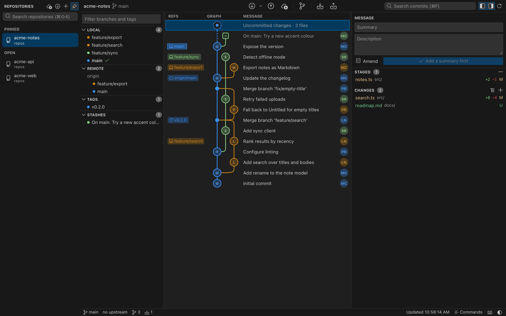
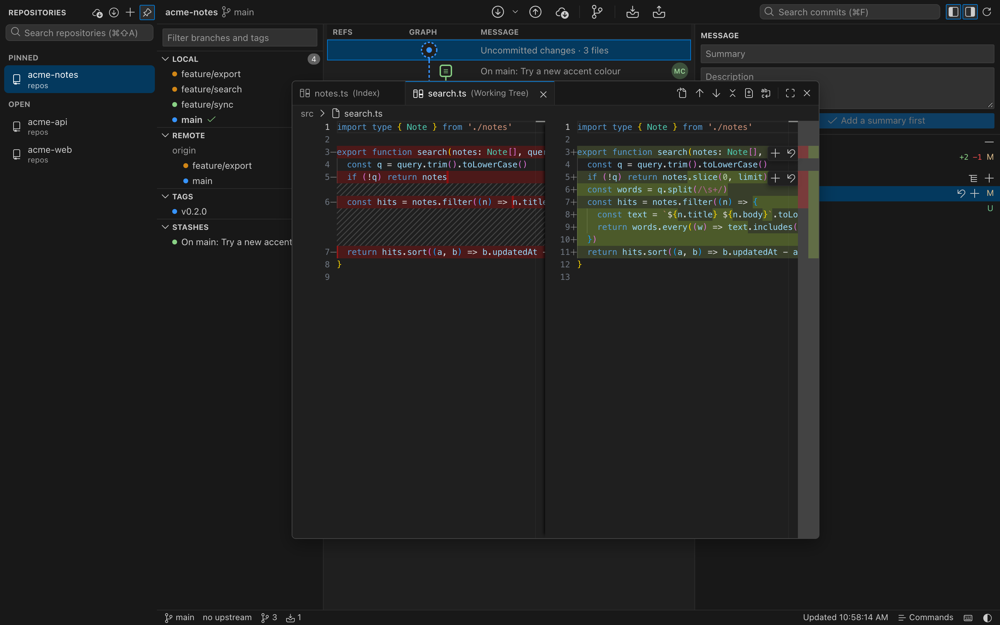
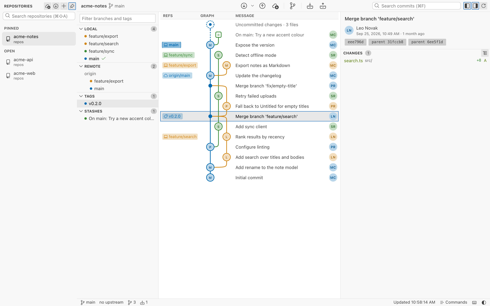

# Ramulus

A local-first Git GUI. Every branch in one graph, editor-grade diffs, and your repositories in tabs. No account, no cloud, no telemetry.

```sh
npx ramulus
```

Run it inside any git repository, or pass a path: `npx ramulus ~/code/app`. Run it in a folder that holds several repositories, such as `~/code`, and it offers to open each one in its own tab. Ramulus starts a small server on 127.0.0.1 on top of the `git` you already have and opens the UI in your browser. It needs Node 20 or newer and `git`, and works on macOS, Windows and Linux.



## Why Ramulus

- **Your git, unchanged.** Every operation runs through the git binary you already use, so SSH keys, credential helpers, hooks and LFS behave exactly as they do in the terminal.
- **Nothing leaves your machine.** The server listens on 127.0.0.1 and every request carries a per-run token. The only outside requests are your own git remotes and avatar lookups on gravatar.com.
- **One command.** No installer, no sign-in, no license key. Close the terminal and it is gone.

Ramulus is Latin for a small branch.

## Features

### History you can read

- A lane graph with merge, stash and work-in-progress nodes, author avatars, and one label per branch with ahead and behind counts against its upstream.
- Search commits by message, author, hash or ref. Solo one or two branches to see only their history.
- Drag a branch label onto a commit to merge or rebase. Right-click any commit, branch, tag or stash for checkout, new branch, tag, cherry-pick, revert, reset, rename and delete.
- Fetch, pull (merge, fast-forward only or rebase) and push. When a merge or rebase stops on conflicts, a banner offers Continue and Abort.

### Diffs and staging



- Every file you click opens as a tab in one floating diff window. Move it, resize it from any edge, or maximize it. The graph and the file lists stay usable underneath.
- The diff runs on Monaco, the open-source editor component: side by side or inline, a +/− gutter, folded unchanged regions, syntax highlighting and word wrap.
- Stage, unstage or discard one change block from the small toolbar beside it. Edit the working-tree side and save with ⌘S.
- Staging writes whole file contents rather than patches, so line endings and byte-order marks survive exactly. If a file changed underneath you, the write is refused instead of guessed.

### Repositories in tabs



- Open several repositories at once from recent repositories, the system folder picker, a typed path, or the repositories found in the folder you started from. They live in a left sidebar that stays docked or auto-hides, with pinned repositories at the top and ⌘⇧A to search. Each one keeps its own selection, filters and draft commit message.
- Pull all (fast-forward only) and Fetch all update every open repository at once.
- Rebase with uncommitted changes: they are stashed and put back for you, and the rebase can be undone afterwards. A rejected push offers rebase, merge or a safe force push instead of an error.
- Only the visible tab watches its folder, so hidden tabs cost nothing and catch up when you come back.
- Light and dark themes, resizable panels, tree or flat file lists with +/− counts, and a status bar with branch, sync and change counts.

### Keyboard

| Keys | Action |
| --- | --- |
| `⌘⇧P` | Command palette: every action, branch and tag |
| `⌘F` | Search commits |
| `⌘⇧A` | Search open and recent repositories |
| `↑` `↓` or `J` `K` | Move through commits |
| `⌘⏎` | Commit |
| `⌘⇧S` / `⌘⇧U` | Stage / unstage everything |
| `⌘S` | Save edits in the diff |
| `⌘B` | New branch from HEAD |
| `⌘L` | Fetch every remote |
| `⌘J` / `⌘K` | Toggle the left / right panel |
| `?` | All shortcuts |

Use Ctrl instead of ⌘ on Windows and Linux.

## Other ways to run it

### In the browser, nothing installed

[a-ahandani.github.io/ramulus](https://a-ahandani.github.io/ramulus/) runs the same UI with git reimplemented in JavaScript over the File System Access API (Chrome and Edge). It is slower on large repositories, cannot use SSH, and has no rebase, cherry-pick or revert. Details in `web/README.md`.

### Native macOS app

A separate native client written in Rust with egui and libgit2. It covers the graph, staging and day-to-day operations; repository tabs, the diff window and the newer look currently live in the browser UI.

Get `Ramulus-<version>-macos-arm64.dmg` from [Releases](https://github.com/a-ahandani/ramulus/releases), open it and drag `Ramulus.app` to Applications. Until the build is notarized, macOS reports a downloaded copy as damaged; clear the download flag once:

```sh
xattr -d com.apple.quarantine /Applications/Ramulus.app
```

To build it yourself you need Rust and `git`:

```sh
git clone https://github.com/a-ahandani/ramulus.git && cd ramulus
scripts/bundle-mac.sh --install     # builds Ramulus.app and the .dmg, copies the app to /Applications
cargo install --path . && ramulus /path/to/repo   # or just the binary
```

`RAMULUS_SIGN_IDENTITY` and `RAMULUS_NOTARY_PROFILE` make the bundle script produce a signed, notarized build.

## Develop

```sh
cd web && npm install && npm run dev   # browser UI with hot reload, served over the helper
npm test                               # in web/ and cli/
cargo run -- /path/to/repo             # native app
cargo test
```

`npm run dev` serves this repository by default; set `RAMULUS_REPO=/path/to/repo` for another one. Discard and Save write real files, so point it at a scratch clone when trying those. Design decisions are written down in `docs/ux.md`.

## License

MIT. Bundled third-party components and their licenses are listed in `THIRD-PARTY-NOTICES.md`.
