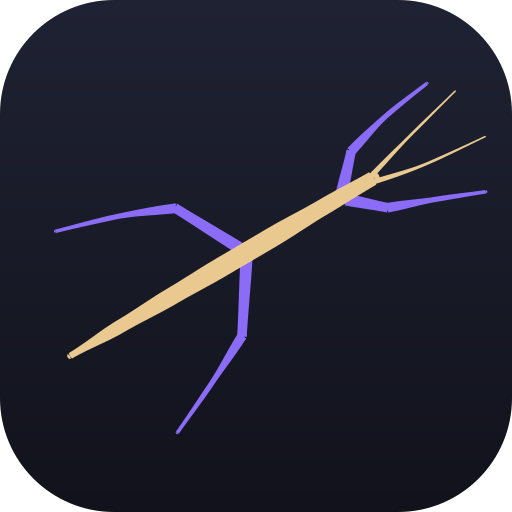
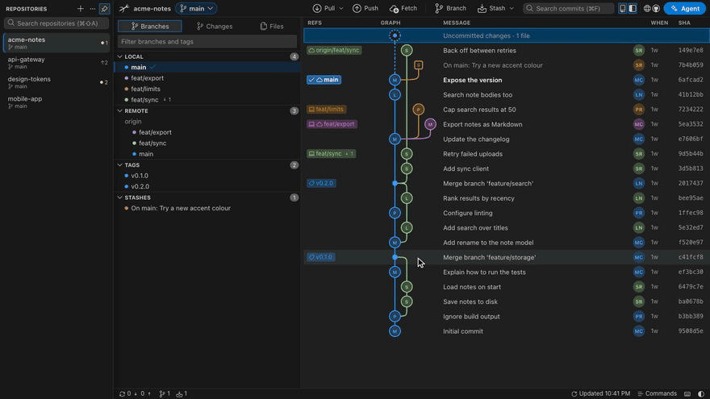

# Ramulus

A local-first Git GUI. Every branch in one graph, editor-grade diffs, and your repositories in a sidebar. No account, no cloud, no telemetry.

```sh
npx ramulus
```

Run it inside any git repository, or pass a path: `npx ramulus ~/code/app`. Run it in a folder that holds several repositories, such as `~/code`, and it offers to open each one in the sidebar. Run it in a repository that has others in its subfolders, and it offers those too. Ramulus starts a small server on 127.0.0.1 on top of the `git` you already have and opens the UI in your browser. It needs Node 20 or newer and `git`, and works on macOS, Windows and Linux.



[Download the demo in full quality (MP4, 1.4 MB)](https://github.com/a-ahandani/ramulus/raw/main/docs/demo.mp4) · [Website](https://a-ahandani.github.io/ramulus/)

## Why Ramulus

- **Your git, unchanged.** Every operation runs through the git binary you already use, so SSH keys, credential helpers, hooks and LFS behave exactly as they do in the terminal.
- **Nothing leaves your machine unless you ask.** The server listens on 127.0.0.1 and every request carries a per-run token. The only outside requests are your own git remotes, avatar lookups on gravatar.com, and, if you turn it on, the AI agent you already use.
- **One command.** No installer, no sign-in, no license key. Close the terminal and it is gone.

Ramulus is Latin for a small branch.

## Features

### History you can read


- A lane graph with merge, stash and work-in-progress nodes, author avatars, and one label per branch with ahead and behind counts against its upstream.
- Search commits by message, author, hash or ref. Solo one or two branches to see only their history.
- The checked-out branch is a solid label with a check mark, sits first in the branch list, and is a chip in the toolbar that switches branches.
- Double-click a remote branch to switch to its local branch and bring it up to date. Your uncommitted changes come along, and a branch with commits of its own is switched to but never rewritten.
- Drag a branch label onto a commit to merge or rebase. A lifted copy follows the pointer and says what the drop will do, the graph scrolls at its edges, and Esc cancels. Right-click any commit, branch, tag or stash for checkout, new branch, tag, cherry-pick, revert, reset, rename and delete.
- Fetch, pull (merge, fast-forward only or rebase) and push. When a merge or rebase stops on conflicts, a banner offers Continue and Abort.

### Diffs and staging


- Every file you click opens as a tab in one diff window that fills the space beside the left panel and follows it as panels change. Move it, resize it from any edge, or maximize it. Unchanged regions are collapsed until you open them.
- The left panel has three tabs: Branches, Changes (the commit box, or the selected commit's files) and Files, which shows the whole working tree with changed files marked. A file opened from Files opens in a plain editor instead of a diff.
- The diff runs on Monaco, the open-source editor component: side by side or inline, a +/− gutter, folded unchanged regions, syntax highlighting and word wrap.
- Stage, unstage or discard one change block from the small toolbar beside it. Edit the working-tree side and save with ⌘S.
- Staging writes whole file contents rather than patches, so line endings and byte-order marks survive exactly. If a file changed underneath you, the write is refused instead of guessed.

### Repositories in tabs


- Open several repositories at once from recent repositories, the system folder picker, a typed path, or the repositories found in the folder you started from. They live in a left sidebar that stays docked or auto-hides, with pinned repositories at the top and ⌘⇧A to search. Each one keeps its own selection, filters and draft commit message.
- Pull all (fast-forward only) and Fetch all update every open repository at once.
- Rebase with uncommitted changes: they are stashed and put back for you, and the rebase can be undone afterwards. A rejected push offers rebase, merge or a safe force push instead of an error.
- Only the visible tab watches its folder, so hidden tabs cost nothing and catch up when you come back.
- Light and dark themes, or any color scheme from [terminalcolors.com](https://terminalcolors.com/): paste the link of its page and the whole app, the diff and the agent terminal take its colors.
- Resizable panels, tree or flat file lists with +/− counts, and a status bar with branch, sync and change counts.

### Your AI agent, if you want one

- Ramulus looks for Claude Code, Codex, Gemini CLI and opencode on your PATH and asks before using any of them. Pick one if several are installed. Each uses its own sign-in, so there is no API key to add.
- The sparkle in the commit box drafts a message from the staged changes, and the one in the new-branch dialog suggests a name. Both fill the field for you to review and edit.
- The Agent button in the top bar (or ⌃\`) opens a panel at the bottom that runs the agent's own interactive tool in the repository's folder, so you can chat with it as you would in your own terminal. Add more tabs with +, for another agent or a plain terminal, and maximize the panel when you want the whole window. The sparkle on a conflicted file pastes a resolve prompt into it without sending it, so you can change it first. The agent then edits the file with its own approvals, and the result shows up as an unstaged change for you to review.
- Every prompt can be edited in AI agent settings in the command palette.

### Keyboard

| Keys | Action |
| --- | --- |
| `⌘⇧P` | Command palette: every action, branch and tag |
| `⌘F` | Search commits |
| `⌘⇧A` | Search open and recent repositories |
| `↑` `↓` or `J` `K` | Move through commits |
| `⌘⏎` | Commit |
| `⌘⇧S` / `⌘⇧U` | Stage / unstage everything |
| `⌘S` | Save edits in the diff |
| `⌘B` | New branch from HEAD |
| `⌘L` | Fetch every remote |
| `⌘J` | Toggle the left panel |
| `` ⌃` `` | Show or hide the agent panel |
| `?` | All shortcuts |

Use Ctrl instead of ⌘ on Windows and Linux.

## Other ways to run it

### In the browser, nothing installed

[a-ahandani.github.io/ramulus/app](https://a-ahandani.github.io/ramulus/app/) runs the same UI with git reimplemented in JavaScript over the File System Access API (Chrome and Edge). It is slower on large repositories, cannot use SSH, and has no rebase, cherry-pick or revert. Details in `web/README.md`.

## Develop

```sh
cd web && npm install && npm run dev   # browser UI with hot reload, served over the helper
npm test                               # in web/ and cli/
```

`npm run dev` serves this repository by default; set `RAMULUS_REPO=/path/to/repo` for another one. Discard and Save write real files, so point it at a scratch clone when trying those. Design decisions are written down in `docs/ux.md`.

To release the npm helper, run `npm version patch --no-git-tag-version` in `cli/`, push that to main, then push a matching tag such as `cli-v0.5.1`. The Publish workflow runs the tests on Linux, macOS and Windows, then publishes to npm through trusted publishing, with provenance and no stored token.

## License

MIT. Bundled third-party components and their licenses are listed in `THIRD-PARTY-NOTICES.md`.
